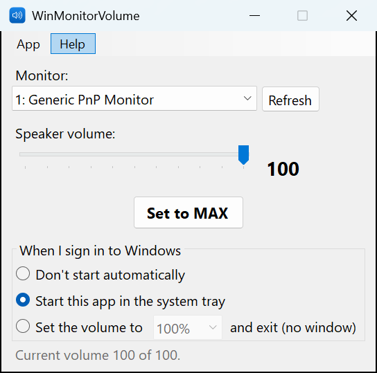
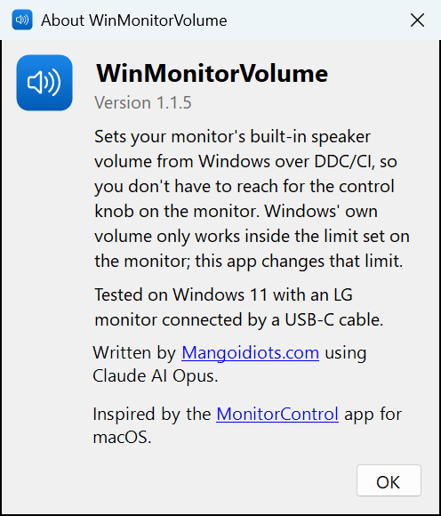

# WinMonitorVolume

Control your monitor's built-in speaker volume from Windows — no reaching for the knob behind the screen.

 

## Why

I use an LG 32U720A-B with both a Windows 11 PC and a Mac mini. On the Mac, the free and open-source [MonitorControl](https://github.com/MonitorControl/MonitorControl) app sets the monitor's speaker volume. On Windows, the system volume only works *within* whatever level is set on the monitor itself, so I kept having to turn the physical knob. I couldn't find a reliable Windows app for this, so I made one.

## What it does

Talks to the monitor over **DDC/CI** (the same way MonitorControl does) and sets its speaker volume directly.

- Slider and a **Set to MAX** button
- Optional system tray icon with quick 0% / 50% / 100% presets
- At sign-in, either start in the tray, or just set the volume (0%, 50% or 100%) and exit with no window
- Command line: `WinMonitorVolume.exe --max`, `--set 50`, or `--tray`

Tested on Windows 11 with an LG monitor connected over USB-C. Other monitors that support DDC/CI volume should work too.

## Install

Before you start, make sure **DDC/CI** is turned on in your monitor's on-screen menu (it usually is by default).

### Microsoft Store (recommended)

WinMonitorVolume has been submitted to the **Microsoft Store** and is waiting for Microsoft's certification. A link will appear here once it is approved. The Store version is signed by Microsoft, installs with one click, starts without any warnings and updates itself.

#### Why the Microsoft Store?

On Windows 11 an unsigned app downloaded from the internet often doesn't get a chance to run:

- **Microsoft Defender SmartScreen** shows *"Windows protected your PC"* and hides the way forward behind **More info → Run anyway**.
- **Smart App Control**, which is turned on for many new Windows 11 PCs, blocks unsigned apps outright, with no "Run anyway" option.

A code-signing certificate costs money every year, and a new one still triggers SmartScreen until it builds up reputation. Publishing through the Microsoft Store gets the app signed by Microsoft, so it runs on any Windows 11 PC without warnings.

The zip downloads below are still available. Use them if you don't want to use the Store, or if your PC doesn't block them.

### Option 1: Just run it (easiest)

1. Download **[WinMonitorVolume-1.1.6-win-x64.zip](https://github.com/venkatarangan/WinMonitorVolume/releases/download/v1.1.6/WinMonitorVolume-1.1.6-win-x64.zip)** (or see all [Releases](https://github.com/venkatarangan/WinMonitorVolume/releases/latest)) and extract it.
2. Double-click **`WinMonitorVolume.exe`**.

That's it — nothing else to install. If Windows shows *"Windows protected your PC"*, click **More info → Run anyway** (the zip build isn't code-signed). If Smart App Control blocks it completely, use the Microsoft Store version instead.

If you plan to use the start-with-Windows options, keep the EXE in a permanent folder first, or use Option 2.

### Option 2: Install with a Start menu shortcut

From the same extracted folder, right-click **`Install.ps1`** → **Run with PowerShell**. Or, in a PowerShell window in that folder:

```powershell
powershell -ExecutionPolicy Bypass -File .\Install.ps1
```

It copies the app to `%LOCALAPPDATA%\Programs\WinMonitorVolume`, adds a Start menu shortcut and launches it. No admin rights needed. Run it again to update; add `-Uninstall` to remove everything.

### Option 3: Small download, if you already have .NET

[`WinMonitorVolume-1.1.6-win-x64-needs-dotnet.zip`](https://github.com/venkatarangan/WinMonitorVolume/releases/download/v1.1.6/WinMonitorVolume-1.1.6-win-x64-needs-dotnet.zip) is under 1 MB but needs the .NET 10 Desktop Runtime:

```powershell
winget install Microsoft.DotNet.DesktopRuntime.10
```

## Starting with Windows

The options under *When I sign in to Windows* appear in Task Manager → *Startup apps*, where you can also turn them off.

- **Zip / `Install.ps1` build:** adds an entry to your user's `Run` registry key (`HKCU\Software\Microsoft\Windows\CurrentVersion\Run`), the standard per-user startup list. If you move the EXE, pick the option again.
- **Microsoft Store build:** Windows ignores the `Run` key for Store apps, so the app switches on its own Windows *startup task* instead. It saves the chosen action (start in the tray, or set the volume) in `%LOCALAPPDATA%\WinMonitorVolume\startup.txt`. If you turned the app off in *Startup apps*, turn it back on in **Settings → Apps → Startup**.

## Troubleshooting

- **"This monitor did not answer"**: turn on DDC/CI in the monitor's menu. Some docks, hubs and KVM switches block DDC/CI, so try a direct cable.
- **Several monitors**: pick the right one from the *Monitor* list. The tray presets and command line apply to every monitor that supports volume control.

## Build

Needs the .NET 10 SDK. In PowerShell, run `Set-ExecutionPolicy -Scope Process -ExecutionPolicy Bypass` first if Windows refuses to run `.ps1` scripts.

This builds both EXEs and the release zips, and bumps the version number in `build-number.txt`:

```powershell
.\build.ps1
```

Output: `publish\` (small EXE), `publish-standalone\` (standalone EXE) and `dist\` (release zips).

### Microsoft Store package

Also needs the Windows SDK (for `makeappx.exe`). This builds an unsigned MSIX for Partner Center, using the Store identity saved in `store/store-identity.json`:

```powershell
.\store\build-msix.ps1
```

See [store/STORE-SUBMISSION.md](store/STORE-SUBMISSION.md) for releasing updates, testing a package locally, and the full submission details.

## Privacy

The app collects no data and makes no network connections. See [PRIVACY.md](PRIVACY.md).

## Credits

Written by [Mangoidiots.com](https://mangoidiots.com) using Claude AI Opus. Inspired by [MonitorControl](https://github.com/MonitorControl/).

## License

[MIT](LICENSE), the same license as MonitorControl.
