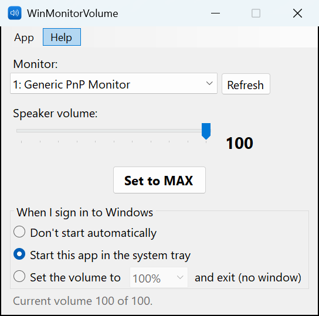
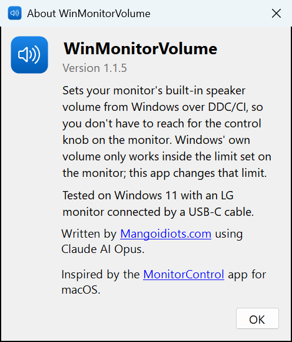

# WinMonitorVolume

Control your monitor's built-in speaker volume from Windows — no reaching for the knob behind the screen.

 

## Why

I use an LG 32U720A-B with both a Windows 11 PC and a Mac mini. On the Mac, the free and open-source [MonitorControl](https://github.com/MonitorControl/MonitorControl) app sets the monitor's speaker volume. On Windows, the system volume only works *within* whatever level is set on the monitor itself, so I kept having to turn the physical knob. I couldn't find a reliable Windows app for this, so I made one.

## What it does

Talks to the monitor over **DDC/CI** (the same way MonitorControl does) and sets its speaker volume directly.

- Slider and a **Set to MAX** button
- Optional system tray icon with quick 0% / 50% / 100% presets
- At sign-in, either start in the tray, or just set the volume (0%, 50% or 100%) and exit with no window
- Command line: `WinMonitorVolume.exe --max`, `--set 50`, or `--tray`

Tested on Windows 11 with an LG monitor connected over USB-C. Other monitors that support DDC/CI volume should work too.

## Install

Before you start, make sure **DDC/CI** is turned on in your monitor's on-screen menu (it usually is by default).

### Option 1: Just run it (easiest)

1. From [Releases](../../releases), download **`WinMonitorVolume-<version>-win-x64.zip`** and extract it.
2. Double-click **`WinMonitorVolume.exe`**.

That's it — nothing else to install. If Windows shows *"Windows protected your PC"*, click **More info → Run anyway** (the app isn't code-signed).

If you plan to use the start-with-Windows options, keep the EXE in a permanent folder first, or use Option 2.

### Option 2: Install with a Start menu shortcut

From the same extracted folder, right-click **`Install.ps1`** → **Run with PowerShell**. Or, in a PowerShell window in that folder:

```powershell
powershell -ExecutionPolicy Bypass -File .\Install.ps1
```

It copies the app to `%LOCALAPPDATA%\Programs\WinMonitorVolume`, adds a Start menu shortcut and launches it. No admin rights needed. Run it again to update; add `-Uninstall` to remove everything.

### Option 3: Small download, if you already have .NET

`WinMonitorVolume-<version>-win-x64-needs-dotnet.zip` is under 1 MB but needs the .NET 10 Desktop Runtime:

```powershell
winget install Microsoft.DotNet.DesktopRuntime.10
```

## Starting with Windows

The options under *When I sign in to Windows* add an entry to your user's `Run` registry key (`HKCU\Software\Microsoft\Windows\CurrentVersion\Run`), the standard per-user startup list. It appears in Task Manager → *Startup apps*, where you can also turn it off. If you move the EXE, pick the option again.

## Troubleshooting

- **"This monitor did not answer"**: turn on DDC/CI in the monitor's menu. Some docks, hubs and KVM switches block DDC/CI, so try a direct cable.
- **Several monitors**: pick the right one from the *Monitor* list. The tray presets and command line apply to every monitor that supports volume control.

## Build

Needs the .NET 10 SDK. This builds both EXEs and the release zips, and bumps the version number in `build-number.txt`:

```powershell
.\build.ps1
```

Output: `publish\` (small EXE), `publish-standalone\` (standalone EXE) and `dist\` (release zips).

## Credits

Written by [Mangoidiots.com](https://mangoidiots.com) using Claude AI Opus. Inspired by [MonitorControl](https://github.com/MonitorControl/).
